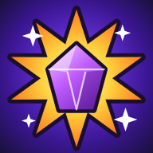

# Blast Squad

A 3v3 hero brawler for phones in the style of the popular mobile arena brawlers. Pick a brawler,
grab gems, kick the ball into the goal or be the last one standing. You play with and against
AI players built to move, aim and make mistakes like people do. A friend's phone can join you
online with a room code. It is a single HTML file: no downloads, no ads, no accounts.



## Play it on your phone

### Option A: install it like an app (recommended, works offline)

1. Turn on GitHub Pages for this repository: **Settings → Pages → Build and deployment →
   Source: "Deploy from a branch"**, pick the branch that holds this game and the
   `/ (root)` folder, then **Save**.
2. After a minute the game is live at `https://<your-user>.github.io/<repo>/blast-squad/`.
3. Open that link on your phone:
   - **Android (Chrome):** menu ⋮ → **Install app** / **Add to Home screen**.
   - **iPhone (Safari):** **Share → Add to Home Screen**.
4. Launch it from the home-screen icon. It opens full screen in landscape and keeps working
   with no connection. A service worker caches everything on first launch.

### Option B: just download the file

`index.html` is completely self-contained: all code, graphics and sound are generated in the
file. Download it and open it in a mobile browser. Progress is saved in the browser.

> Hold the phone sideways. The game is played in landscape, like the original.

## Controls

| Touch | Keyboard + mouse | Gamepad | Action |
| --- | --- | --- | --- |
| Drag on the left side | WASD / arrows | Left stick | Move (a floating joystick) |
| Tap the red button | F, or left click | R1 / RT | Attack, auto-aimed at the nearest enemy you can see |
| Drag the red button, release | Mouse aim + left click | Right stick + R1 | Aimed attack. Drag back to the centre to cancel |
| Yellow button (when charged) | Right click / Space | L1 / LT | Super. Tap to auto-aim, drag to aim |
| Small button | Q / E | A | Gadget (3 per match, from power 7) |
| Speech bubble | T, then 1-8 / Shift+1-5 | Y | Quick chat and emotes |

Holding the ball in Blast Ball, the attack button **kicks** (a tap kicks at the goal) and the
super button **passes**, lobbing the ball over walls. A left-handed layout is in Settings.

## Modes

| Mode | Players | How to win |
| --- | --- | --- |
| **Gem Rush** | 3v3 | A mine spawns a gem every 7 s. Hold 10+ gems as a team, and more than the enemy, for a 15 s countdown. Dying drops your gems. |
| **Showdown** | 10, every player for themselves | Break boxes for power cubes (+health and damage each), take others' cubes when they fall, and stay out of the closing poison. Last one standing wins; placement decides the trophies. |
| **Blast Ball** | 3v3 | First to 2 goals. Pick the ball up by touching it, kick it or pass it. Tied after 2:30, sudden-death overtime with the walls removed. |
| **Knockout** | 3v3 | Best of 3 rounds with no respawns. Poison closes in if a round drags on. |
| **Bounty** | 3v3 | Everyone wears stars (2, up to 7 for a hot streak). Take someone down to score their stars. Most stars after 2 minutes wins. |

There are 11 maps, at least 2 per mode. The event list shows 4 slots on a timer, like the
original: Gem Rush, Showdown and Blast Ball, plus a slot that alternates between Knockout and
Bounty every 4 hours.

## Brawlers

15 brawlers from Starting to Legendary rarity, covering the classic archetypes:

| Brawler | Rarity | Plays like |
| --- | --- | --- |
| Nova | Starting | Shotgun brawler; super knocks back and breaks walls |
| Dax | Rare | Gunslinger with long bursts |
| Brick | Rare | Tank who punches and leaps in |
| Bramble | Rare | Shockwave plus a pet bear |
| Pip | Rare | Bomb thrower that lobs over walls |
| Melody | Rare | Healer with a piercing sound wave |
| Sizzle | Super Rare | Burning puddles |
| Gizmo | Super Rare | Bouncing orbs and a turret |
| Volt | Super Rare | Instant beam and a slowing storm |
| Hawk | Epic | Sniper who escapes by leaping |
| Frost | Epic | Snowball fan and a push-back wind |
| Shade | Mythic | Dashing assassin with life steal |
| Zip | Mythic | Fast skirmisher with a team speed boost |
| Specter | Legendary | Close-range blades and invisibility |
| Thorn | Legendary | Splitting cactus balls and a spike field |

Each has 3 ammo bars, a super charged by hitting enemies, a gadget from power 7 and a star
power from power 9. Health regenerates after a few seconds out of combat.

## AI players that play like people

Offline, every teammate and opponent is an AI. They are built from a model of a human player
rather than a script with perfect information:

- **Perception.** An AI only knows what its own phone screen would show:
  - bushes hide enemies
  - nothing outside the screen is known: teammates and the ball that leave the screen are
    remembered where they were last seen
  - unseen shots are heard only roughly, and where a lobbed bomb will land is judged from its
    shadow, roughly at first
  - it guesses movement from what it saw, without reading speeds from the game
- **Reactions** follow a human distribution. Beginners take about 0.37 s and experts about
  0.23 s, never under 0.13 s.
- **Thumbs.** The move stick turns at a limited speed and jukes sideways in fights; how much each
  AI jukes is personal. Aiming is a quick flick that overshoots a little; the aim's own error is
  corrected only after a moment, so it misses more at long range or under pressure. A dodge
  starts after a reaction and a moment to pick a side, and sometimes misjudges the shot. A bar of
  ammo that just refilled is noticed a beat later, not on the exact frame. A burning puddle that
  lands on it is also noticed only after a reaction. It shoots down a pet chasing it or a turret in
  reach before the brawler behind it. Beginners mostly tap auto-aim.
- **Decisions.** Each AI weighs options such as hold the lane, fight, retreat to heal, grab
  gems, carry or clear the ball, farm power cubes, ambush from a bush or dodge the poison. It
  sticks to a plan unless something clearly better comes up, instead of flickering between them.
  Each AI has its own aggression, patience, greed, teamwork and tilt, and makes human mistakes
  (beginners more often: overextending, chasing, forgetting the objective).
- **Teamwork** happens through the same quick-chat pins you use. They arrive a little late and
  are followed according to each AI's teamwork.
- **Skill follows trophies.** Low trophies meet beginner-like players and high trophies meet
  sharp ones. AI players have human-style names and pick brawlers that suit the map.

`tools/ai-test.cjs` checks these behaviours against human ranges:
- reaction times, hit rates, stick movement and idle time
- retreat timing and super timing
- that no AI ever gets stuck
- that better players win more often

During your own matches, `window.__BS.telemetry()` in the browser console measures you the same
way.

## Progression

- **Trophies per brawler.** Wins and losses follow the original's tables. Showdown pays by
  placement.
- **Faster start.** The original's slow climb to 1,000 trophies is sped up. Below 1,000 total
  trophies, wins pay triple, and a brawler under 100 trophies never loses any. That takes about
  60-80 matches instead of hundreds. Above 1,000 the original rates apply.
- **Trophy Road.** Brawler unlocks and resources, denser below 1,000.
- **Power levels 1-11** cost coins and power points (original costs). Gadgets unlock at 7 and
  star powers at 9.
- **Free pass.** 50 tiers fed by match XP and quests, then bonus drops.
- **Starr-style drops.** Reward rolls that can upgrade in rarity, from the first 5 wins each
  day, the road and the pass.
- **Daily quests and a shop** with daily offers.

## Friendly battle (online)

From **Friends**, one phone taps **Create room** and gets a room code. The other types the code
and taps **Join**. The host picks the mode and whether you play on the same team or against each
other. Every other slot is filled by AI players. Friendly battles don't change trophies.

How it works:
- The two phones connect directly to each other (WebRTC). A free public
  [PeerJS](https://peerjs.com/) signaling server only introduces them using the room code.
- The host's phone runs the match. The other phone predicts its own brawler's movement so the
  controls feel immediate, and shows everyone else slightly in the past to keep them smooth.
- If your friend drops out for a moment, an AI holds their brawler until they are back.
- You can use your own signaling server: run
  [peerjs-server](https://github.com/peers/peerjs-server) and add `?signal=your.server:9000` to
  the URL on both phones.
- If the connection fails, both phones may be behind strict mobile-carrier networks. Moving one
  or both to Wi-Fi usually fixes it.

## Development

The source lives in `src/` and is bundled into the single-file `index.html`:

```bash
node blast-squad/build.mjs   # bundle src/ -> index.html and stamp sw.js
```

- `src/DESIGN.md`: the contracts between modules (sim, modes, input word, percepts, view, net)
- `src/js/*.js`: game modules, concatenated in file-name order:
  - `06-sim.js` and `07-modes.js`: the deterministic 30 Hz simulation and the five modes
  - `08-perceive.js`, `09-mind.js` and `10-motor.js`: the AI players
  - `12-net.js` and `13-sync.js`: friendly battles
  - `17-view.js`: the renderer
- `src/index.template.html`, `src/sw.template.js`: page shell, CSS and offline service worker

Tests and tools (Node 22; the browser tests use Playwright with Chromium, and the online test
also needs the `peer` package):

```bash
node blast-squad/tools/sim-test.cjs                 # rules, every mode and map, every brawler's kit, determinism
node blast-squad/tools/ai-test.cjs                  # AI human-likeness per skill tier, anti-cheat, every mode
node blast-squad/tools/balance-test.cjs [N]         # N bot matches: brawler and side win rates
node blast-squad/tools/progress-sim.cjs --assert    # matches needed to reach 1,000 trophies
NODE_PATH=$(npm root -g) node blast-squad/tools/smoke-test.cjs [shots-dir]   # menus, rewards and a match in every mode
NODE_PATH=$(npm root -g) node blast-squad/tools/render-test.cjs [shots-dir]  # renderer, every HUD, frame time
NODE_PATH=$(npm root -g) node blast-squad/tools/input-test.cjs               # touch, keyboard and gamepad controls
npm install --prefix /tmp/peer peer
NODE_PATH=$(npm root -g):/tmp/peer/node_modules node blast-squad/tools/net-test.cjs   # two phones, 150 ms lag and 5% loss
```

The characters, art, names and mode names are original. Only the game mechanics and structure
follow the genre's best-known game.

---

## 한국어 안내

**Blast Squad(블래스트 스쿼드)** 는 휴대폰으로 즐기는 3대3 브롤러 게임입니다. 인기 모바일 브롤러
게임의 조작과 규칙, 성장 구조를 최대한 그대로 따랐습니다. 오프라인에서도 AI 동료와 AI 상대가 사람처럼
움직이고, 조준하고, 실수합니다.

**설치해서 하기 (추천)**

저장소 **Settings → Pages** 에서 이 게임이 있는 브랜치와 `/ (root)` 를 선택해 저장하면
`https://<사용자명>.github.io/<저장소>/blast-squad/` 주소가 생깁니다. 휴대폰으로 열고 안드로이드는
**앱 설치**, 아이폰은 **공유 → 홈 화면에 추가** 를 누르세요. 이후에는 인터넷 없이도 실행됩니다.
휴대폰은 가로로 들고 하세요.

**조작**

- 왼쪽을 끌면 이동합니다.
- 빨간 버튼을 톡 치면 자동 조준 공격, 끌었다 놓으면 조준 공격입니다(가운데로 되돌리면 취소).
- 노란 버튼은 슈퍼, 작은 버튼은 가젯입니다(파워 7부터 한 판에 3번).
- 말풍선 버튼은 빠른 채팅과 이모트입니다.
- 볼 모드에서 공을 들고 있으면 공격 버튼은 **슛**, 슈퍼 버튼은 벽을 넘기는 **패스** 입니다.

**모드 (맵은 모드마다 2개 이상, 모두 11개)**

| 모드 | 설명 |
| --- | --- |
| 젬 러시 (젬 그랩) | 3대3. 젬 10개 이상을 들고 15초 버티면 승리합니다. |
| 쇼다운 | 10명 개인전. 상자를 부숴 파워 큐브를 모으고, 좁혀 오는 독가스를 피해 마지막까지 살아남으세요. 순위에 따라 트로피가 정해집니다. |
| 블래스트 볼 (브롤 볼) | 3대3. 먼저 2골을 넣으면 승리합니다. 2분 30초가 지나도 동점이면 벽이 사라진 연장전(골든 골)을 합니다. |
| 녹아웃 | 3대3. 부활 없는 3판 2선승제입니다. |
| 바운티 | 3대3. 머리 위의 별(2~7개)을 쓰러뜨려 빼앗고, 2분 뒤 별이 많은 팀이 이깁니다. |

**사람 같은 AI**

- 자기 휴대폰 화면에 보이는 것만 압니다. 부쉬 속이나 화면 밖은 모릅니다.
- 반응 시간이 사람과 비슷합니다. 초보는 약 0.37초, 고수는 약 0.23초이고, 0.13초보다 빠른 반응은
  없습니다.
- 엄지로 하듯 조준이 살짝 지나쳤다가 바로잡히고, 멀거나 위급할 때 더 빗나갑니다.
- 발밑에 떨어진 장판도 반응 시간이 지나야 알아채고 빠져나갑니다. 쫓아오는 곰이나 사거리 안의 포탑은
  뒤에 있는 브롤러보다 먼저 부숩니다.
- 각자 공격성, 인내심, 욕심, 팀워크, 멘탈(틸트) 성향이 있고 가끔 사람 같은 실수를 합니다.
- 팀원끼리 퀵 채팅 핀으로 소통합니다. 핀은 조금 늦게 도착합니다.
- 트로피가 높을수록 더 잘하는 상대를 만납니다.

**성장**

- 브롤러별 트로피, 트로피 로드, 파워 레벨 1~11, 무료 패스, 스타 드롭 방식의 보상, 일일 퀘스트와
  상점이 있습니다.
- 원작에서 오래 걸리는 **1,000 트로피까지만 빠르게** 했습니다. 총 트로피 1,000 미만에서는 승리
  트로피가 3배이고, 100 트로피 미만인 브롤러는 트로피를 잃지 않습니다. 평균 60~80판이면 1,000에
  도달합니다.
- 1,000 트로피부터는 원작과 같은 속도입니다.

**친구 대전 (온라인)**

- **Friends** 에서 한 사람이 **Create room** 을 누르면 방 코드가 나옵니다. 친구가 그 코드를 입력하고
  **Join** 을 누르면 됩니다.
- 같은 팀 또는 상대 팀을 고를 수 있고, 남는 자리는 AI가 채웁니다. 친선전이라 트로피는 변하지
  않습니다.
- 두 휴대폰이 직접 연결됩니다. 친구의 연결이 잠깐 끊기면 그동안 AI가 대신 조종합니다.
- 연결이 안 되면 한쪽 또는 양쪽 휴대폰을 와이파이에 연결해 보세요.
