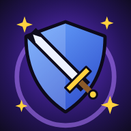

# Realm Raiders

A co-op action RPG for phones and computers. Pick from 18 heroes with their own powers, raid five
realms full of monsters, beat their bosses, collect blessings and gear, and level up your guild.
Play with bots, with friends on the same screen, or online with a room code. It is a single HTML
file: no downloads, no ads, no accounts.



## Play it

### Option A: install it like an app (recommended, works offline)

1. Turn on GitHub Pages for this repository: **Settings → Pages → Build and deployment →
   Source: "Deploy from a branch"**, pick the branch that holds this game and the
   `/ (root)` folder, then **Save**.
2. After a minute the game is live at `https://<your-user>.github.io/<repo>/realm-raiders/`.
3. Open that link on your phone:
   - **Android (Chrome):** menu ⋮ → **Install app** / **Add to Home screen**.
   - **iPhone (Safari):** **Share → Add to Home Screen**.
4. Launch it from the home-screen icon. It opens full screen in landscape and keeps working with no
   connection (online play still needs one).

The game always plays sideways: if you hold your phone upright, it turns itself so you can just
rotate the phone.

### Languages

English and Korean (한국어). Korean phones start in Korean; switch any time with the language
button on the main menu, in the pause menu, or in Settings. Online, each player sees their own
language.

### Option B: just open the file

`index.html` is completely self-contained (all code, graphics, sound and music are generated in the
file). Open it in a browser on a phone or a computer. Progress is saved in the browser.

## Controls

Your hero **attacks automatically** whatever is in range. You move, dodge, and choose when to use
your **skill**, your **ultimate** (it charges as you deal damage) and your **dash** (a quick roll
you can't be hit during). Red areas are attacks about to land: step out of them.

| | Move | Skill | Ultimate | Dash |
| --- | --- | --- | --- | --- |
| Touch | Drag on the left | Skill button (drag it to aim) | Ult button (drag to aim) | Dash button |
| Keyboard, player 1 | WASD | Q (or left click) | E (or right click) | Space |
| Keyboard, player 2 | IJKL | U | O | ; |
| Keyboard, player 3 | Arrows | Numpad 1 | Numpad 2 | Numpad 0 |
| Gamepad (up to 4) | Left stick | X / RB | B / Y / RT | A / LB / LT |

Alone at a keyboard you can also use the arrows with J/K/L, and the mouse to aim. Esc or Start opens
the menu. The touch buttons are see-through so they don't hide the fight; Settings → Touch buttons
switches between See-through, Medium and Solid.

## Modes

- **Adventure.** Each realm has 7 rooms and a boss. After a room, choose a portal by the reward it
  shows: a **Blessing** (pick 1 of 3 run upgrades), a **Gold hoard**, a **Gear chest**, a healing
  **Spring** or an **Elite den** (a tough fight that pays a blessing and gear). Clearing a realm
  unlocks the next one and its **Heroic** difficulty; Heroic unlocks **Mythic**.
- **The Abyss.** Endless floors of mixed monsters, a boss every 5th floor. How deep can you go?
- **Arena.** Hero against hero: 1v1 to 4v4 teams or free-for-all, first to 5, 10 or 15 knockouts.
  Power-ups spawn in the middle. Levels and gear don't count here, so it's fair for everyone.

Fallen heroes can be revived by an ally standing next to them. Gold, gear and hero XP stay after
every run, win or lose.

## Heroes

| Hero | Role | Skill | Ultimate |
| --- | --- | --- | --- |
| Brand | Tank | Shield Bash | Rallying Banner (party takes half damage, taunts) |
| Ember | Mage | Flame Wave | Meteor Storm |
| Hawke | Ranger | Volley | Arrow Rain |
| Willow | Healer | Healing Bloom | Grove of Life (revives the fallen) |
| Rime | Mage | Frost Nova | Blizzard |
| Gale | Fighter | Cyclone Kick | Tornado |
| Gizmo | Summoner | Deploy Turret | Rocket Barrage |
| Volt | Mage | Thunder Dash | Thunderstorm |
| Nyx | Assassin | Shadow Step | Death Lotus |
| Krag | Fighter | Whirlwind | Blood Rage |
| Vex | Mage | Toxic Cloud | Plague Burst |
| Morrow | Summoner | Raise Dead | Soul Harvest |
| Lyra | Support | Battle Hymn | Crescendo |
| Atlas | Tank | Boulder Toss | Earthquake |
| Sol | Healer | Sanctuary | Divine Intervention |
| Chrona | Support | Rewind | Time Stop |
| Umbra | Mage | Black Hole | Collapse |
| Drakon | Fighter | Dragon Leap | Dragonform |

Four heroes are free; most others are bought with gold. Chrona, Umbra and Drakon are unlocked by
achievements. Every hero also has a passive (for example Rime's frozen foes take more damage from
the whole party, Vex's poisoned foes hit softer).

## Progression

- **Hero levels 1-30** from XP earned in runs.
- **Gear:** weapons, armor and charms in Common, Rare, Epic, Legendary and Mythic rarity, with
  random stats. Legendary and Mythic items have a unique power (revive once per run, chain
  lightning, lifesteal fangs and more). Upgrade items to +10 with gold, or salvage them.
- **35 blessings** to build a different hero each run, from +damage to Spirit Blades, Stormlord or
  Phoenix Heart.
- **Camp upgrades:** permanent damage, health, gold, XP, luck, rerolls and a once-per-run revive.
- **44 achievements** with gold rewards, **3 daily quests** with a bonus chest, and a **daily free
  chest**.

## Monsters and bosses

25 kinds of monsters with their own behaviour (chargers, archers, casters, bombers, leapers,
summoners, laser eyes...) and elite versions with affixes (Swift, Brutal, Armored, Volatile,
Frostbound, Vampiric). Five bosses with an enraged second phase: Gorethorn the Treant King, Morvane
the Bone Lich, Infernus the Molten Golem, Glacia the Frost Wyrm and the Hollow King.

## Bots

Bots play the same heroes through the same controls as a player. They dodge telegraphed attacks and
incoming shots after a human-like reaction time, revive fallen allies, keep their range (ranged
heroes kite, melee heroes dive), retreat when hurt, and use their skills and ultimates when it is
worth it (healing when allies are hurt, area attacks on groups, ultimates on bosses). Choose Easy,
Normal or Hard bots in Settings. Bots can play any hero, even ones you haven't unlocked yet.

## Playing with friends

- **Same screen:** open Adventure, Abyss or Arena, and each friend presses a key from their keys
  (U, or Numpad 1) or a button on a gamepad to join. The camera keeps everyone in view.
- **Online (up to 4):** under **Play with friends**, one player creates a room and shares the
  4-letter code; the others join with it. Bots fill the empty places. Each player keeps their own
  heroes, gear and progress, and gets their own blessing choices and loot.

How online play works:
- Devices connect directly to each other (WebRTC). A free public [PeerJS](https://peerjs.com/)
  signaling server only introduces them using the room code.
- The host's device runs the game. Guests move their own hero right away and see everything else
  smoothly, slightly in the past.
- If a friend drops out, a bot takes over their hero.
- You can use your own signaling server: run
  [peerjs-server](https://github.com/peers/peerjs-server) and add `?signal=your.server:9000` to the
  URL on every device. If a connection fails on mobile data, try Wi-Fi.
- For testing on one computer, open two tabs with `?net=bc` at the end of the URL: they find each
  other without any network.

## Development

The source lives in `src/` and is bundled into the single-file `index.html`:

```bash
node realm-raiders/build.mjs   # bundle src/ -> index.html and stamp sw.js
```

- `src/js/*.js`: game modules, concatenated in file-name order into one scope:
  - `02-data.js`: heroes, monsters, bosses, realms, blessings, gear, achievements, quests
  - `02b-lang.js`: Korean translations (`tr()` for fixed text, `trx()` for labels built in game)
  - `03-world.js`: the 60 Hz combat simulation (units, statuses, projectiles, areas, pickups)
  - `04-abilities.js`: every hero's attack, skill, ultimate and passive
  - `05-enemies.js`: monster and boss behaviour
  - `06-bots.js`: hero bots
  - `07-modes.js`: Adventure, Abyss and Arena
  - `08-meta.js`: save, gear, hero levels, camp, achievements, daily quests
  - `09-input.js`: touch, keyboards, gamepads, mouse
  - `10-net.js`, `11-sync.js`: online play (transport, host snapshots, guest mirror)
  - `12-fx.js`, `13-render.js`, `14-audio.js`: effects, rendering and HUD, sound and music
  - `15-ui.js`, `16-main.js`: menus and the game loop
- `src/index.template.html`, `src/sw.template.js`: page shell, CSS and offline service worker

Tests (Node 22; the browser tests use Playwright with Chromium):

```bash
node realm-raiders/tools/net-test.cjs                                      # host/guest sync over an in-memory link
node realm-raiders/tools/lang-test.cjs                                     # every text shown has a Korean translation
NODE_PATH=$(npm root -g) node realm-raiders/tools/smoke-test.cjs [shots]   # menus, an adventure and an arena match on autopilot
NODE_PATH=$(npm root -g) node realm-raiders/tools/smoke-test.cjs [shots] --desktop
NODE_PATH=$(npm root -g) node realm-raiders/tools/smoke-test.cjs [shots] --portrait --ko   # upright phone, Korean
NODE_PATH=$(npm root -g) node realm-raiders/tools/online-test.cjs [shots]  # two tabs play online together
NODE_PATH=$(npm root -g) node realm-raiders/tools/make-icons.cjs           # regenerates the app icons
```

---

## 한국어 안내

**Realm Raiders(렐름 레이더스)** 는 휴대폰과 컴퓨터에서 하는 협동 액션 RPG입니다. 각자 다른 능력을 가진
영웅 18명 중 하나를 골라 다섯 개의 영역을 공략하고, 보스를 쓰러뜨리고, 축복과 장비를 모아 성장하세요.

- **한국어 지원:** 게임 전체가 한국어로 나옵니다. 한국어 휴대폰에서는 자동으로 한국어로 시작하고, 메인 메뉴·일시 정지
  메뉴·설정의 언어 버튼으로 언제든 바꿀 수 있습니다. 온라인에서도 각자 자기 언어로 보입니다.
- **항상 가로 화면:** 휴대폰을 세로로 들고 있으면 게임이 알아서 옆으로 돌아갑니다. 휴대폰만 돌려서 하면 됩니다.
- **반투명 버튼:** 터치 버튼이 반투명이라 전투 화면을 가리지 않습니다. 설정 → 터치 버튼에서 반투명 · 중간 · 진하게 중에 고를 수 있습니다.

- **설치해서 하기 (추천):** 저장소 **Settings → Pages** 에서 이 게임이 있는 브랜치와 `/ (root)` 를 선택해
  저장하면 `https://<사용자명>.github.io/<저장소>/realm-raiders/` 주소가 생깁니다. 휴대폰으로 열고
  안드로이드는 **앱 설치**, 아이폰은 **공유 → 홈 화면에 추가** 를 누르세요. 인터넷 없이도 실행됩니다.
- **조작:** 영웅은 사거리 안의 적을 **자동으로 공격**합니다. 이동하고, 피하고, **스킬 · 궁극기 · 대시**를
  쓸 때를 고르세요. 빨간 영역은 곧 떨어질 공격이니 피하세요! 터치는 왼쪽을 드래그해 이동하고
  오른쪽 버튼을 누르거나 드래그해서 조준합니다. 키보드는 WASD · Q 스킬 · E 궁극기 · Space 대시.
- **모드:** 모험(영역 5개, 방 7개와 보스), 심연(끝없는 층), 아레나(영웅끼리 팀전 또는 개인전).
- **성장:** 영웅 레벨 1~30, 희귀도별 장비와 강화(+10), 런마다 고르는 축복 35종, 캠프 업그레이드,
  업적 44개, 일일 퀘스트와 매일 무료 상자.
- **봇:** 봇은 공격을 피하고, 쓰러진 동료를 살리고, 상황에 맞게 스킬과 궁극기를 씁니다. 설정에서
  쉬움 · 보통 · 어려움을 고를 수 있습니다.
- **친구와 함께:** 한 화면에서는 친구가 자기 키(U, 숫자패드 1)나 게임패드 버튼을 누르면 참가합니다.
  온라인은 **Play with friends** 에서 한 명이 방을 만들고 4글자 코드를 알려 주면 최대 4명이 함께 할 수
  있습니다. 빈자리는 봇이 채웁니다.
